# PostgreSQL Database Schema & Relationships

### Accounts Payable (AP) Automation Software — Templegate Technologies

This document details the PostgreSQL relational database schema, data models, table constraints, foreign key relationships, and indexes implemented in the system.

---

## 1. Entity-Relationship (ER) Diagram

```mermaid
erDiagram
    VENDOR ||--o{ PURCHASE_ORDER : "supplies"
    VENDOR ||--o{ GOODS_RECEIPT_NOTE : "delivers to"
    VENDOR ||--o{ INVOICE : "bills"
    VENDOR ||--o{ PAYMENT_RECORD : "receives"
    VENDOR ||--o{ AUDIT_LOG : "referenced in"

    PURCHASE_ORDER ||--|{ PURCHASE_ORDER_ITEM : "contains"
    PURCHASE_ORDER ||--o{ GOODS_RECEIPT_NOTE : "receives against"
    PURCHASE_ORDER ||--o{ INVOICE : "matched against"

    GOODS_RECEIPT_NOTE ||--|{ GOODS_RECEIPT_NOTE_ITEM : "inspects"
    PURCHASE_ORDER_ITEM ||--o{ GOODS_RECEIPT_NOTE_ITEM : "received from"
    GOODS_RECEIPT_NOTE ||--o{ INVOICE : "verified against"

    INVOICE ||--|{ INVOICE_LINE_ITEM : "itemizes"
    INVOICE ||--o{ WORKFLOW_APPROVAL_ACTION : "history"
    INVOICE ||--o{ PAYMENT_RECORD : "settled by"
    INVOICE ||--o{ AUDIT_LOG : "tracked by"

    APPROVAL_MATRIX_RULE {
        int id PK
        varchar tier_name
        decimal min_amount
        decimal max_amount
        varchar approver_role
        int sla_hours
        bool auto_escalate
    }

    VENDOR {
        int id PK
        varchar vendor_code UK
        varchar name
        varchar trade_name
        varchar category
        varchar email
        varchar phone
        varchar gstin
        varchar pan
        bool gst_verified
        varchar bank_name
        varchar account_number
        varchar ifsc_code
        bool bank_verified
        varchar status
    }

    PURCHASE_ORDER {
        int id PK
        varchar po_number UK
        int vendor_id FK
        date issue_date
        date delivery_date
        decimal subtotal
        decimal tax_amount
        decimal total_amount
        varchar status
        varchar payment_terms
    }

    PURCHASE_ORDER_ITEM {
        int id PK
        int po_id FK
        int line_number
        varchar item_code
        varchar description
        varchar hsn_sac
        decimal quantity_ordered
        decimal quantity_received
        decimal quantity_billed
        decimal unit_price
        decimal tax_rate
        decimal total_amount
    }

    GOODS_RECEIPT_NOTE {
        int id PK
        varchar grn_number UK
        int po_id FK
        int vendor_id FK
        date received_date
        varchar delivery_challan_no
        varchar received_by
        varchar warehouse_location
        varchar status
    }

    GOODS_RECEIPT_NOTE_ITEM {
        int id PK
        int grn_id FK
        int po_item_id FK
        varchar description
        decimal quantity_received
        decimal quantity_accepted
        decimal quantity_rejected
        varchar inspection_remarks
    }

    INVOICE {
        int id PK
        varchar invoice_number
        int vendor_id FK
        int po_id FK
        int grn_id FK
        date invoice_date
        date due_date
        decimal subtotal
        decimal tax_amount
        decimal cgst
        decimal sgst
        decimal igst
        decimal grand_total
        varchar file
        varchar file_type
        varchar source
        varchar ocr_status
        float ocr_confidence_score
        text ocr_raw_text
        jsonb ocr_extracted_data
        varchar validation_status
        jsonb validation_errors
        bool is_duplicate
        bool gst_validated
        bool amount_validated
        bool vendor_validated
        varchar matching_type
        varchar matching_status
        jsonb matching_discrepancy_details
        varchar approval_tier
        varchar approval_status
        varchar current_approver_role
        bool is_escalated
        text escalation_reason
        varchar payment_status
    }

    INVOICE_LINE_ITEM {
        int id PK
        int invoice_id FK
        int line_number
        varchar item_description
        varchar hsn_sac
        decimal quantity
        varchar unit_of_measure
        decimal unit_price
        decimal tax_rate
        decimal tax_amount
        decimal total_amount
    }

    WORKFLOW_APPROVAL_ACTION {
        int id PK
        int invoice_id FK
        varchar approver_name
        varchar approver_role
        varchar action
        varchar tier
        text comments
        timestamp timestamp
    }

    PAYMENT_RECORD {
        int id PK
        varchar payment_reference UK
        int invoice_id FK
        int vendor_id FK
        decimal amount_paid
        date payment_date
        varchar payment_method
        varchar transaction_utr
        varchar bank_batch_id
        varchar status
        varchar beneficiary_account
        varchar beneficiary_ifsc
        bool payment_advice_generated
    }

    AUDIT_LOG {
        int id PK
        int invoice_id FK
        int vendor_id FK
        varchar action_type
        varchar actor_name
        varchar actor_role
        varchar ip_address
        text description
        jsonb delta_snapshot
        timestamp timestamp
    }
```

---

## 2. Table-by-Table Data Dictionary

### Table: `core_vendor` (Vendor Master)
Stores verified procurement suppliers, compliance tax identifiers, and banking remittance credentials.
| Column | Type | Nullable | Description / Constraint |
|---|---|:---:|---|
| `id` | `BIGSERIAL` | No | Primary Key |
| `vendor_code` | `VARCHAR(50)` | No | Unique supplier code (e.g. `VEN-IND-001`) |
| `name` | `VARCHAR(255)` | No | Legal registered business name |
| `trade_name` | `VARCHAR(255)` | Yes | Trade DBA name |
| `category` | `VARCHAR(100)` | No | Industry category (e.g. Hardware, Cloud) |
| `contact_person` | `VARCHAR(150)` | Yes | Designated contact point |
| `email` | `VARCHAR(254)` | No | Official billing email |
| `phone` | `VARCHAR(30)` | Yes | Telephone / Mobile number |
| `address` | `TEXT` | Yes | Registered physical address |
| `gstin` | `VARCHAR(20)` | Yes | 15-character Indian GSTIN/TIN identifier |
| `pan` | `VARCHAR(20)` | Yes | 10-character Permanent Account Number |
| `gst_verified` | `BOOLEAN` | No | Default `False`, statutory verification flag |
| `bank_name` | `VARCHAR(150)` | Yes | Remittance bank name (e.g. HDFC Bank) |
| `account_number` | `VARCHAR(50)` | Yes | Supplier settlement bank account number |
| `ifsc_code` | `VARCHAR(20)` | Yes | 11-character Indian RTGS/NEFT IFSC code |
| `account_type` | `VARCHAR(30)` | No | Account classification (`Current`, `Savings`) |
| `bank_verified` | `BOOLEAN` | No | Bank verification flag for direct payouts |
| `status` | `VARCHAR(30)` | No | `DRAFT`, `PENDING_REVIEW`, `APPROVED`, `ACTIVE`, `SUSPENDED` |

---

### Table: `core_invoice` (Invoices & OCR Metadata)
Central transactional record storing capture source, OCR extraction metrics, validation flags, 3-way matching status, and approval workflow tier.
| Column | Type | Nullable | Description / Constraint |
|---|---|:---:|---|
| `id` | `BIGSERIAL` | No | Primary Key |
| `invoice_number` | `VARCHAR(80)` | Yes | Invoiced bill number |
| `vendor_id` | `BIGINT` | Yes | Foreign Key referencing `core_vendor.id` (ON DELETE SET NULL) |
| `po_id` | `BIGINT` | Yes | Foreign Key referencing `core_purchaseorder.id` (ON DELETE SET NULL) |
| `grn_id` | `BIGINT` | Yes | Foreign Key referencing `core_goodsreceiptnote.id` (ON DELETE SET NULL) |
| `invoice_date` | `DATE` | Yes | Statutory invoice billing date |
| `due_date` | `DATE` | Yes | Payment obligation maturity date |
| `subtotal` | `DECIMAL(14,2)`| No | Taxable value before tax |
| `tax_amount` | `DECIMAL(14,2)`| No | Total tax amount |
| `cgst` | `DECIMAL(14,2)`| No | Central GST amount |
| `sgst` | `DECIMAL(14,2)`| No | State GST amount |
| `igst` | `DECIMAL(14,2)`| No | Integrated Inter-state GST amount |
| `grand_total` | `DECIMAL(14,2)`| No | Net claim amount |
| `file` | `VARCHAR(100)` | Yes | File storage path |
| `file_type` | `VARCHAR(30)` | No | `PDF`, `JPG`, `PNG`, `TIFF` |
| `source` | `VARCHAR(30)` | No | `MANUAL_UPLOAD`, `BULK_UPLOAD`, `EMAIL_INGESTION`, `DRAG_DROP` |
| `ocr_status` | `VARCHAR(30)` | No | `PENDING`, `PROCESSING`, `SUCCESS`, `PARTIAL`, `FAILED` |
| `ocr_confidence_score` | `FLOAT` | No | Average extraction accuracy % (0.0 to 100.0) |
| `ocr_extracted_data` | `JSONB` | No | Extracted JSON key-value schema |
| `validation_status` | `VARCHAR(30)` | No | `PENDING`, `PASSED`, `WARNING`, `FAILED` |
| `is_duplicate` | `BOOLEAN` | No | Duplicate detection alert flag |
| `gst_validated` | `BOOLEAN` | No | GSTIN structure and tax rate check |
| `amount_validated` | `BOOLEAN` | No | Math check: `Sum(items) == subtotal` & `subtotal + tax == total` |
| `matching_type` | `VARCHAR(30)` | No | `NONE`, `TWO_WAY`, `THREE_WAY` |
| `matching_status` | `VARCHAR(30)` | No | `UNMATCHED`, `MATCHED`, `DISCREPANCY`, `OVERRIDDEN` |
| `matching_discrepancy_details` | `JSONB` | No | Tolerance and line variance detail object |
| `approval_tier` | `VARCHAR(20)` | No | `TIER_1` (<50k), `TIER_2` (50k-200k), `TIER_3` (>200k) |
| `approval_status` | `VARCHAR(30)` | No | `DRAFT`, `PENDING_APPROVAL`, `APPROVED`, `REJECTED`, `ESCALATED`, `ON_HOLD` |
| `current_approver_role`| `VARCHAR(30)` | No | `AP_CLERK`, `AP_MANAGER`, `FINANCE_DIRECTOR`, `CFO` |
| `is_escalated` | `BOOLEAN` | No | SLA breach auto-escalate flag |
| `payment_status` | `VARCHAR(30)` | No | `UNPAID`, `SCHEDULED`, `PROCESSING`, `PAID`, `FAILED` |

---

### Table: `core_invoicelineitem` (Itemized Materials)
Line-item material details extracted from the invoice table.
| Column | Type | Nullable | Description |
|---|---|:---:|---|
| `id` | `BIGSERIAL` | No | Primary Key |
| `invoice_id` | `BIGINT` | No | Foreign Key referencing `core_invoice.id` (ON DELETE CASCADE) |
| `line_number` | `INTEGER` | No | Ordinal line index (1, 2, 3...) |
| `item_description` | `VARCHAR(255)` | No | Material or service description |
| `hsn_sac` | `VARCHAR(20)` | Yes | Indian HSN/SAC statutory classification code |
| `quantity` | `DECIMAL(10,2)`| No | Invoiced quantity |
| `unit_price` | `DECIMAL(12,2)`| No | Unit rate |
| `tax_rate` | `DECIMAL(5,2)` | No | Tax rate % (e.g. 18.00) |
| `tax_amount` | `DECIMAL(12,2)`| No | Calculated line GST |
| `total_amount` | `DECIMAL(14,2)`| No | Line total inclusive of tax |

---

### Table: `core_purchaseorder` & `core_purchaseorderitem`
Stores procurement commitments, authorized rates, and quantity baselines for 2-Way and 3-Way matching.
- **Key Columns**: `po_number` (Unique), `vendor_id` (FK), `subtotal`, `tax_amount`, `total_amount`, `status` (`OPEN`, `PARTIALLY_RECEIVED`, `FULLY_RECEIVED`, `BILLED`).

### Table: `core_goodsreceiptnote` & `core_goodsreceiptnoteitem`
Stores warehouse intake receipts, physical inspection results, accepted quantities, and delivery challan references.
- **Key Columns**: `grn_number` (Unique), `po_id` (FK), `vendor_id` (FK), `received_by`, `status` (`RECEIVED`, `VERIFIED`, `REJECTED`).

### Table: `core_paymentrecord` (Treasury Disbursements)
Stores settled banking disbursements, UTR tracking, and bank batch references.
- **Key Columns**: `payment_reference` (Unique), `invoice_id` (FK), `vendor_id` (FK), `amount_paid`, `payment_method` (`NEFT`, `RTGS`, `IMPS`), `transaction_utr`, `bank_batch_id`, `status` (`SETTLED`).

### Table: `core_auditlog` (Immutable Event Ledger)
Chronological forensic audit log of all system actions.
- **Key Columns**: `action_type`, `actor_name`, `actor_role`, `ip_address`, `description`, `delta_snapshot` (`JSONB`), `timestamp`.
